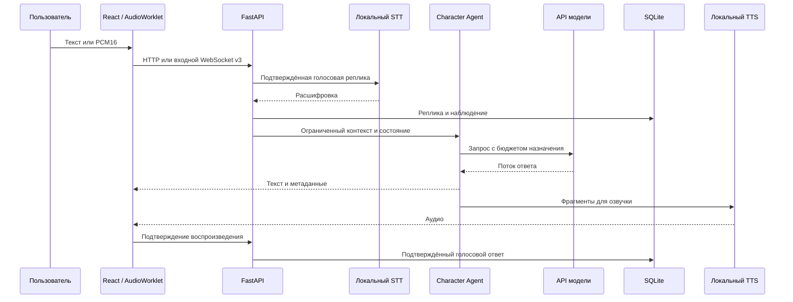

[Документация](index.md) / Архитектура

# Архитектура

Оболочка Windows управляет жизненным циклом Iris. Интерфейс отвечает за ввод
и воспроизведение, ядро — за диалог и данные, Unity — за необязательный аватар.
Отказ отдельной функции должен оставлять доступными остальные возможности.

| Компонент | Исходники | Ответственность |
| :--- | :--- | :--- |
| Tauri | [`apps/desktop`](../apps/desktop/) | Окно, значок в области уведомлений, единственный экземпляр, запуск ядра и Unity, хранилище ключей |
| React | [`apps/web`](../apps/web/) | Диалог, журнал, память, настройки, события, AudioWorklet и воспроизведение |
| FastAPI | [`apps/backend`](../apps/backend/) | Оркестрация разговора, LLM, STT/TTS, SQLite, память, модели и API |
| Unity | [`apps/avatar-unity`](../apps/avatar-unity/) | VRM, мимика, жесты, синхронизация губ и размещение аватара |

## Запуск и границы доступа

Tauri выбирает свободный порт `127.0.0.1`, создаёт временный токен и передаёт
адрес ядра интерфейсу и Unity. HTTP и WebSocket защищены этим токеном. Ядро
не является сетевым или многопользовательским сервисом.

API-ключи Tauri читает из Windows Credential Manager и передаёт ядру через
анонимный канал стандартного ввода. Секреты из `.env` и унаследованного
окружения игнорируются. Браузерный режим разработки с фиксированным портом
отделён от управляемого запуска и не получает пользовательские ключи.

## Путь реплики

Текст и голос используют общий Character Agent, контекст и память. Голосовой
путь добавляет VAD, Smart Turn и владение поколением ответа. Переподключение
инвалидирует прежнего владельца: запоздалые STT/LLM/TTS-задачи не публикуют
результат в новую сессию. Для голосового ответа история учитывает подтверждённые
сегменты воспроизведения.

Поиск выполняется до фактического ответа и сохраняет собственные метаданные:
попытки, кэш, источники и достаточность сведений. Внешний текст рассматривается
как данные. Подробности — в [поиске](awareness.md).

## Владельцы логики

| Модуль ядра | Что ему принадлежит |
| :--- | :--- |
| `app/agents/character` | Инструкции персонажа, вызовы модели и проверка ответа |
| `app/skills` | Каталог доступных функций, схемы аргументов, проверка и выполнение навыков |
| `app/context` | Контекст из личности, сводок, последних реплик и выбранной памяти |
| `app/conversation` | Наблюдения, решение отвечать, настроение, отношения и состояние воспроизведения |
| `app/storage` | Timeline, эпизоды, память, аудит, задания и миграции |
| `app/environment` | Веб-поиск, чтение источников и новости |
| [`apps/protocol`](../apps/protocol/) | Общий Character Protocol v3 для React, ядра и Unity |

Стабильный префикс инструкций отделён от динамического состояния, чтобы
сохранять повторное использование кэша модели. Для обычных назначений DeepSeek
отключается режим рассуждения; вывод и повторные попытки ограничены.
`/debug/llm/usage` показывает расход каждой физической попытки без содержимого
запроса и ответа. Поисковые служебные вызовы учитываются отдельно от основного
ответа и включаются в общий расход хода.

## Данные и фоновые задачи

SQLite — каноническое хранилище. `TimelineStore` содержит сообщения, эпизоды,
сводки, память со свидетельствами и аудитом, задания, состояние персонажа и
записи Coding Agent. Несекретные настройки живут в `settings.json`: новое
состояние публикуется после успешной атомарной записи файла.

Жизненный цикл приложения контролирует исполнителей сводок эпизодов,
синхронизации индекса, консолидации памяти, рефлексий и Coding Agent. При
неожиданном выходе публикуется `backend.worker_failed`; повторный запуск
использует ограниченную увеличивающуюся задержку. Остановка дожидается
завершения контролирующих задач до закрытия зависимостей.

Блокирующая работа SQLite и файловой системы в интерактивных асинхронных
путях переносится в пул потоков. Память извлекается в фоне: подходящие реплики
объединяются в окно консолидации, явная просьба запомнить или исправить факт
может ускорить задание. Семантический индекс перестраивается из SQLite.

## Границы отказов

- Ошибка LLM или TTS не удаляет сохранённую пользовательскую реплику.
- Ошибка озвучки оставляет доступным текст ответа.
- При отказе семантического поиска остаётся текстовый поиск SQLite FTS.
- Ошибка записи настроек сохраняет прежнее опубликованное состояние.
- Задачи старого поколения не публикуются после переподключения.
- Coding Agent выполняет команды только в Docker и не переходит к оболочке хоста.

---

[Эксплуатация](operations.md) · [API](api.md) · [Живой разговор](live-conversation.md)
