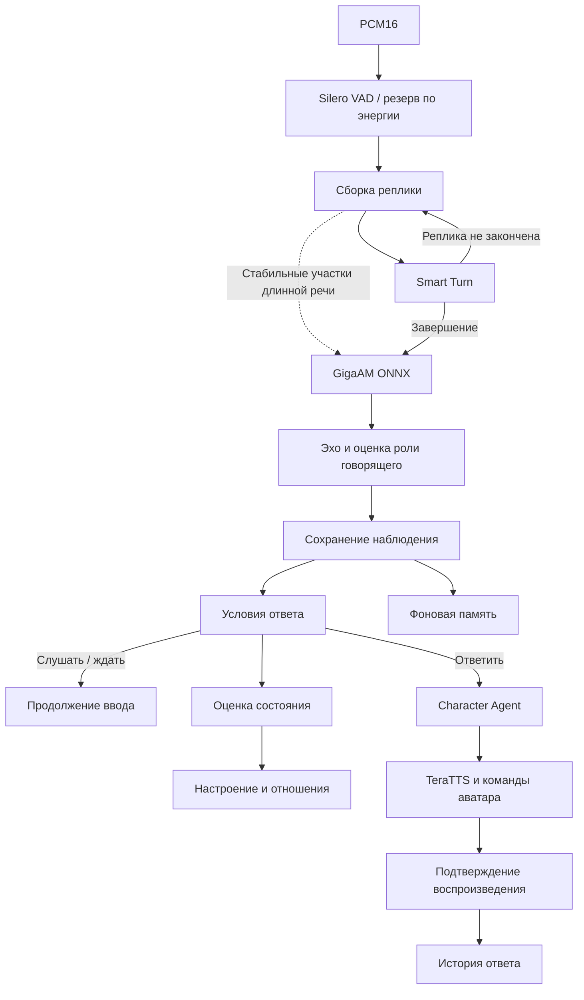

<sub>[Документация](index.md) / Голос</sub>

# Голосовой разговор

Live Conversation — единственный голосовой путь Iris. После включения
микрофон непрерывно передаёт PCM16; ядро определяет реплики и запускает
ответ. Текстовый чат остаётся доступным. Старый
`live_conversation_enabled` сохраняется для миграций и считается включённым.

## Поток



## Состояния и принадлежность результата

```text
idle → listening → endpoint_pending → transcribing → deciding
     → generating → speaking → listening
```

`suspended` и `closed` обозначают остановленную и закрытую сессии.
Подтверждённое начало речи увеличивает `generation`.
Результат STT, решения или подтверждения воспроизведения старого поколения
не может поздно изменить историю.

Перебивание выполняется так:

1. Интерфейс останавливает локальный плеер до ожидания сетевого ответа.
2. Ядро меняет поколение и отменяет активные LLM/TTS/avatar-задачи.
3. Проверка активного контекста блокирует поздние аудиосегменты.
4. История сохраняет подтверждённую воспроизведённую часть ответа со статусом
   `interrupted`.

Готовый WAV может остаться во временном кэше до штатной очистки,
но не продолжает воспроизводиться.

## Определение конца реплики

VAD считает паузу только при непрерывной тишине. Тихий речевой кадр сбрасывает
ожидание. Smart Turn проверяет кандидат раньше консервативной границы:
в профиле `natural` примерно после 350 мс тишины. Незавершённый кандидат
остаётся в `pending_turn` и принимает продолжение.

Без готовой модели `natural` использует более терпеливую границу около
1100 мс. Таймаут или ошибка Smart Turn не означают немедленного ответа;
действует консервативное ожидание продолжения. `short` и `patient`
изменяют профиль паузы.

Модель получает последние восемь секунд 16 кГц PCM.
Локальный NumPy frontend строит Whisper-совместимый `80×800` log-mel.
Smart Turn не импортирует `transformers`.

Закреплённая модель:

| Поле | Значение |
| :--- | :--- |
| ID / файл | `smart-turn-v3.2` / `smart-turn-v3.2-cpu.onnx` |
| Revision | `f766f81d3cfdf7737ac64aad813d91bbfd56bf93` |
| SHA-256 | `2bb026316b14a660486a75b1733cd3fbab8c2fd0314dc9af7be49f8cca967e4f` |
| Размер | 8 679 182 байта |
| Лицензия в каталоге моделей | BSD-2-Clause |

Фактическую запись сверяйте с [Model Manager](../apps/backend/app/model_manager/service.py).
PCM продолжает поступать во время вычислений; новая речь инвалидирует старый
результат. При отсутствии модели, неподдерживаемой частоте или ошибке действует
аудиорезерв.

## Наблюдение, память и состояние

Порядок подтверждённой реплики:

1. Сохраняется исходная расшифровка пользователя.
2. Безопасная интерпретация может записываться в `corrected_content`.
3. Роль, адресация, конец реплики, уверенность STT и эхо фиксируются в metadata
   и `conversation_observations`.
4. Применяются ограниченные изменения настроения и отношений.
5. Подходящее наблюдение основного говорящего проходит условия новизны и
   при необходимости обновляет одно задание памяти.
6. Политика разговора выбирает ответ, ожидание, молчание или реакцию.

`assistant_echo`, `other`, `unknown`, сомнительный STT и инкогнито
не создают активные факты автоматически. Наблюдение не зависит от того,
смогла ли Iris ответить.

Снимок состояния хранит настроение и отношения, а не факты памяти.
Обычное изменение отношения ограничено `0.03`, серьёзное подтверждённое —
`0.10`; дневной бюджет аспекта — `0.15`. Повторы ослабляются.

Эмоции затухают по реальному времени. Множители восстановления:
`fast=0.6`, `natural=1.0`, `slow=1.6`.
При перезапуске к снимку применяется прошедшее время;
отложенные реакции и незавершённые поколения не восстанавливаются.

## Решение отвечать

Эхо, незавершённая реплика, прямое обращение, приглашение, роль говорящего,
пауза между инициативами и речевой бюджет проверяются локально.
Семантическая оценка — ограниченный JSON-вызов с таймаутом 3,5 секунды
без отдельного запроса исправления.

Для уверенного обращения основного говорящего в `one_to_one` ответ может
начаться параллельно оценке состояния. Групповой разговор, сомнительный STT и
просьба изменить регистр сохраняют последовательную проверку. При сбое
действует локальное правило; эмоциональная классификация по ключевым словам
не подставляется.

Оценка роли не использует биометрию. В `one_to_one` исходное предположение —
`primary`, в `group` — `unknown`; уверенность повышается по обращению,
связности и явным признакам. Причины видны в диагностике.

Отложенная очередь: максимум три элемента, TTL 45 секунд, одна попытка.
Новая пользовательская генерация отменяет очередь. Инициатива проверяет
тишину, паузу 90 секунд, предел двух инициатив за десять минут и долю речи
Iris не более 35% в двухминутном окне.

## WebSocket v3

Входной канал: `/ws/voice-input/{session_id}?version=3`.

```text
voice.input.start {
  protocol_version: 3,
  sample_rate,
  channels: 1,
  format: "pcm_s16le",
  language,
  capture_profile: "live",
  capture_settings,
  capture_constraints,
  supported_constraints
}
<непрерывные бинарные PCM16-фреймы>
voice.input.stop
```

Это схема сообщения, а не готовый JSON: значения задаются клиентом.
Поле `mode` и версии 1/2 отклоняются.

`stop` корректно завершает текущий ввод: подтверждённые задачи финализации
и STT дожидаются окончания, начатый ответ не отменяется.
Разрыв или переподключение инвалидирует владение прежнего соединения,
отменяет его задачи и переданную дальше генерацию.
Новое соединение получает собственное владение.

События содержат `session_id`, `generation`, `turn_id`, `utterance_id`
и `created_at`. Основные типы:

```text
conversation.phase             conversation.turn_candidate
conversation.turn_completed    conversation.observation
conversation.decision          conversation.silent
conversation.reaction          conversation.deferred
conversation.state             conversation.cancelled
conversation.echo_rejected
```

`voice.input.transcript` содержит `raw_transcript`, `transcript`,
`confidence`, а при вторичном распознавании — `fallback/fallback_reason`.
Молчание не создаёт сообщение ассистента.

Клиент подтверждает `playback.segment.started`,
`playback.segment.finished` и `playback.finished`.
Голосовой ответ в истории строится из подтверждённых сегментов.

## Хранение и диагностика

Таблицы: `character_state_snapshots`, `character_state_events`,
`character_participant_states`, `conversation_observations`.
Номер схемы задаёт `LATEST_SCHEMA_VERSION` в
[`timeline.py`](../apps/backend/app/storage/timeline.py).
До миграций создаётся копия. Очистка памяти и сброс данных персонажа
имеют разные границы. В инкогнито состояние этого пути остаётся в RAM.

`CONVERSATION_DIAGNOSTICS_ENABLED=true` включает
`GET /conversation/debug/{session_id}`: фаза, поколение, наблюдения, решение,
бюджеты, задачи, роль, очередь и последняя отмена. В dev-интерфейсе доступен
инспектор. Endpoint не возвращает сырой звук, полные инструкции модели
или скрытые рассуждения.

## Распознавание во время длинной речи

`VOICE_STT_PROCESS_WHILE_SPEAKING=true` позволяет GigaAM ONNX заранее
распознавать стабильные участки. Разрез между 16 и 23 секундами становится
независимым от будущего аудио после накопления 28 секунд.
Сохраняются FP32, перекрытие 0,75 с и объединение текста.

На окончании реплики участки сравниваются с финальным PCM байт в байт;
изменившиеся распознаются заново. Ошибка возвращает полную обработку.
Короткие реплики идут обычным путём. Кэш — только RAM; промежуточный текст
не публикуется и освобождается при отмене.

`VOICE_LIVE_PARALLEL_APPRAISAL=true` включает параллельную оценку для
подходящих обращений. Ответ получает последний готовый снимок и текущую
реплику. Оценка применяется один раз; новое поколение отменяет старую задачу.
Завершение ответа дожидается её результата для сохранения порядка состояния.

Исторические числа и ограничения измерений находятся в
[задержке голоса](voice-latency.md) и [сравнении STT](stt-comparison.md).

## Проверка отказов

Проверьте недоступный Smart Turn, вторичный STT, эхо, инкогнито, отмену LLM/TTS,
переподключение на каждой стадии и позднее подтверждение старого аудио.
Затем выполните синтетический и реальный прогон по
[эксплуатации](operations.md#синтетический-длительный-прогон).

Фикстуры — [`tests/fixtures/live_audio`](../tests/fixtures/live_audio/).
Изменение WAV требует обновления manifest и проверки реальной акустики.
Синтетика не доказывает работу микрофона, системного подавления эха и колонок.

---

[API](api.md) · [Задержка](voice-latency.md) · [Память](chroma-memory.md)
