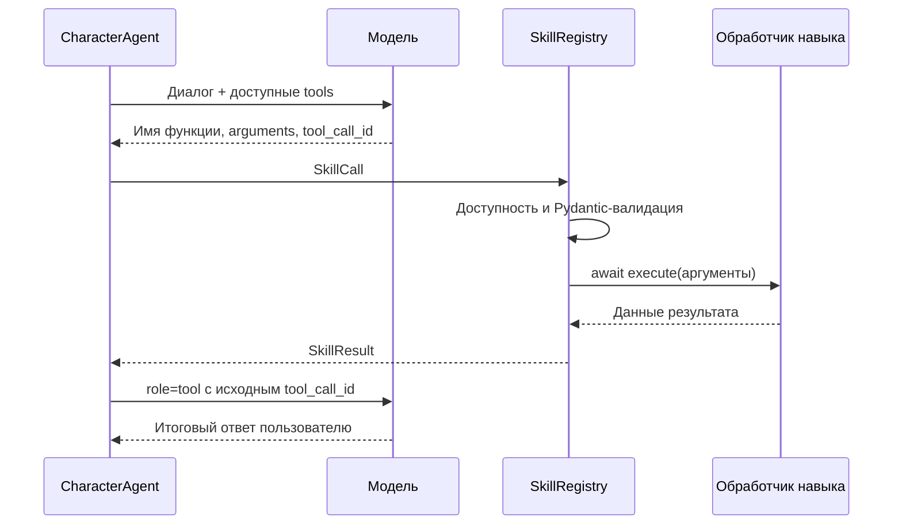

<sub>[Документация](index.md) / Разработка навыков</sub>

# Разработка навыков Iris

Навык — зарегистрированная backend-функция, которую Ирис может выбрать во время
диалога. Модель определяет, когда её вызвать и какие аргументы передать; Python
проверяет аргументы, выполняет действие и возвращает результат модели для ответа.
Навыком может быть локальная справка, расчёт, чтение состояния приложения или
обращение к внешнему сервису. Он не обязан пользоваться интернетом.

Это руководство описывает текущую реализацию Iris 0.9.1. Сейчас в приложении
подключён `web_search`. Пример `local_clock` ниже — учебный: его код нужно создать
и зарегистрировать отдельно. Добавление одного Markdown-файла не подключает
навык к приложению.

## Где находится реализация

| Файл | Ответственность |
| :--- | :--- |
| [`skills/runtime.py`](../apps/backend/app/skills/runtime.py) | `Skill`, `SkillCall`, `SkillResult`, реестр, схемы аргументов, проверка и выполнение |
| [`character/agent.py`](../apps/backend/app/agents/character/agent.py) | Доступные навыки текущего хода, вызов, результат, лимит операций и метаданные |
| [`llm/base.py`](../apps/backend/app/llm/base.py) | `generate_with_tools`, `stream_with_tools`, поля вызовов и результатов |
| [`providers/deepseek.py`](../apps/backend/app/llm/providers/deepseek.py) | Native function calling, сбор потоковых аргументов и сохранение ID |
| [`routes/chat.py`](../apps/backend/app/api/routes/chat.py) | Создание агента для двух текстовых путей и сохранение метаданных |
| [`backend/main.py`](../apps/backend/main.py) | Создание агента для двух голосовых путей и сохранение метаданных |

Краткий обзор поведения — в [навыках в разговоре](conversation-skills.md).

## Путь вызова



DeepSeek получает функции через `tools` и выбирает их с `tool_choice=auto`.
Отдельного запроса к модели для планирования навыка нет. Внутренний адаптер
преобразует native-вызов в скрытую команду, которую понимает CharacterAgent;
при продолжении сохраняется настоящий обмен `assistant.tool_calls` / `tool`.
Служебная команда и аргументы не становятся репликой для чата или TTS.

Провайдеры без native tools используют совместимый протокол, описанный в
[обзоре](conversation-skills.md#вызов-и-ответ). Реализация навыка от этого не меняется.
Вызовы провайдера, разбор команд и передачу `tool_call_id` новый обработчик
реализовывать не должен.

## Контракт Skill

| Поле | Как заполнять |
| :--- | :--- |
| `name` | Стабильное имя в `snake_case`: `local_clock`, `project_status`. Для вызова допустимо `^[a-z][a-z0-9_]*$`, не более 64 символов |
| `description` | Что делает навык, когда полезен и чем отличается от других функций |
| `arguments` | Класс Pydantic-модели, не её экземпляр. Из него получается JSON Schema для модели |
| `execute` | Асинхронная функция, принимающая один экземпляр модели аргументов и возвращающая данные |
| `available` | Обычная синхронная функция без аргументов, возвращающая `bool` |
| `timeout_seconds` | Таймаут обработчика; по умолчанию 20 секунд |

Не используйте имя `web_search`: оно уже зарегистрировано самим CharacterAgent.
Повторное имя при регистрации вызывает `ValueError`.

Модель видит имя, описание и схему аргументов. Ей не передаётся Python-код
обработчика. Настройки, клиент сервиса, разрешения и состояние сессии передавайте
обработчику через фабрику или замыкание, а не через аргументы, которые заполняет ИИ.

### Описание и аргументы

Описание должно помогать выбирать функцию. Например: «Возвращает точное время
этого компьютера до секунды, локальное или UTC. Используй, когда нужна точная
отметка времени». Одного «полезный инструмент» для выбора недостаточно.

Используйте `ConfigDict(extra="forbid", strict=True)`, понятные описания полей,
ограничения длины и диапазонов, `Literal` для небольших наборов значений.
`strict=True` относится к локальной Pydantic-валидации; это не включение beta
strict-mode у API модели.

Не передавайте от модели произвольные команды оболочки, токены доступа или
права выполнения. Для работы с выбранным пользователем проектом лучше принимать
его ID и разрешать ID в backend-сервисе, чем доверять сгенерированному пути.
Сложная схема допустима: `tools()` передаёт полную `model_json_schema()`, включая
определения вложенных моделей. Совместимость схемы проверяйте с используемым
провайдером.

## Пример: локальные часы

Создайте `apps/backend/app/skills/local_clock.py` со следующим содержимым:

```python
from collections.abc import Callable
from datetime import datetime, timezone
from typing import Literal

from pydantic import BaseModel, ConfigDict, Field

from apps.backend.app.skills.runtime import Skill


class LocalClockArguments(BaseModel):
    model_config = ConfigDict(extra="forbid", strict=True)
    zone: Literal["local", "utc"] = Field(
        default="local",
        description="local — время компьютера, utc — время UTC",
    )


def make_local_clock_skill(*, enabled: Callable[[], bool]) -> Skill:
    async def execute(arguments: LocalClockArguments) -> dict[str, str]:
        now = datetime.now(timezone.utc)
        if arguments.zone == "local":
            now = now.astimezone()
        return {
            "zone": arguments.zone,
            "datetime": now.isoformat(timespec="seconds"),
        }

    return Skill(
        name="local_clock",
        description=(
            "Возвращает точное время этого компьютера до секунды, "
            "локальное или UTC. Используй, когда нужна точная отметка времени."
        ),
        arguments=LocalClockArguments,
        execute=execute,
        available=enabled,
        timeout_seconds=1.0,
    )
```

Обработчик возвращает факты, из которых Ирис составляет ответ. Он не должен сам
вызывать LLM, формировать Character Protocol, публиковать речь или записывать
реплику в историю. `async def` без `await` допустим для такого короткого вычисления.

`enabled` здесь — callback доступности. Для всегда доступных локальных часов
можно передать `lambda: True`. Если появится настройка включения навыка,
callback должен читать её актуальное состояние. Нового поля настроек для этого
примера в текущем приложении нет.

## Регистрация во всех режимах

CharacterAgent принимает дополнительные навыки параметром `skills: tuple[Skill, ...]`.
Для единообразного подключения можно создать
`apps/backend/app/skills/catalog.py`:

```python
from apps.backend.app.skills.local_clock import make_local_clock_skill
from apps.backend.app.skills.runtime import Skill


def make_conversation_skills() -> tuple[Skill, ...]:
    return (make_local_clock_skill(enabled=lambda: True),)
```

Эта фабрика — предлагаемое место расширения, в текущем коде такого файла нет.
Затем импортируйте её в места создания агента и дополните существующие вызовы
конструктора аргументом:

```python
skills=make_conversation_skills(),
```

Не удаляйте остальные аргументы конструктора: они подключают историю, память,
стиль диалога и сервисы приложения.

| Место | Что нужно подключить |
| :--- | :--- |
| [`routes/chat.py`](../apps/backend/app/api/routes/chat.py) | Обычный текстовый ответ и потоковый текстовый ответ — два конструктора |
| [`backend/main.py`](../apps/backend/main.py) | Обычный голосовой ответ и `conversation_deferred_response` — два конструктора |

Пропущенный конструктор приведёт к тому, что навык будет работать лишь в части
режимов. `web_search` добавлять в фабрику не нужно — он остаётся встроенным.
Для проверки изменений в готовом приложении нужна новая сборка по
[порядку выпуска](release-runbook.md); уже запущенный `.exe` не читает новые
Python-модули из рабочего дерева.

Для навыка с сервисом фабрика может принимать клиент, настройки и callback
разрешений. Повторно используйте клиент приложения; не создавайте новый HTTP-клиент
на каждую реплику. Состояние конкретного вызова держите локально в `execute`:
один сервис может обслуживать несколько агентов.

## Доступность и действия с последствиями

`available()` проверяется при подготовке списка функций и снова непосредственно
перед исполнением. Это должен быть быстрый callback без сетевых запросов,
изменений состояния и `async`. Не сохраняйте результат проверки один раз навсегда.

Запрет веб-поиска относится к `web_search`. Новый локальный навык сам определяет
свою доступность; настройки `web_search_enabled` не являются общим выключателем
всех функций.

В контракте `Skill` пока нет встроенной политики подтверждений, разрешений,
транзакций или отката. Если навык пишет файлы, меняет настройки или обращается
к сервису с последствиями, эти проверки должен выполнить соответствующий сервис
приложения. Вызов модели сам по себе не подтверждает разрешение на действие.
Узкие аргументы и Pydantic не заменяют такую проверку.

Для действия с подтверждением обработчик может вернуть прикладное состояние
`needs_confirmation` и ID подготовленного предложения. Реальное применение
происходит через существующий подтверждаемый путь приложения. Это схема
расширения, а не готовая функция реестра; отдельного универсального UI
подтверждения навыков сейчас нет. Coding Agent использует собственный путь
[применения изменений](coding-agent.md).

## Результаты и ошибки

Возвращайте небольшие JSON-совместимые объекты: словари, списки, строки, числа,
`bool`, `None`. Даты преобразуйте в ISO-строки. Для файлов возвращайте нужную
выдержку и идентификатор, а не всё содержимое или двоичные данные.

Для навыков, отличных от поиска, модель получает оболочку:

```json
{
  "skill": "local_clock",
  "status": "ok",
  "data": {"zone": "utc", "datetime": "2026-10-12T12:00:00+00:00"}
}
```

В настоящее время вся сериализованная оболочка ограничивается первыми
3200 символами. Обрезка может затронуть значение и целостность JSON, поэтому
сокращайте результат в обработчике заранее. Для результатов больше этого
объёма нужно отдельно проектировать выборку или передачу файла.

| Статус | Что означает |
| :--- | :--- |
| `ok` | Обработчик вернул результат; это не автоматическое доказательство успешности прикладного действия |
| `invalid` | Вызов или аргументы не прошли проверку |
| `unknown` | Такого имени нет в реестре |
| `disabled` | Навык недоступен по callback |
| `timeout` | Истёк таймаут обработчика |
| `error` | Обработчик выбросил обычное исключение |
| `limit` | CharacterAgent уже принял операцию навыка в этом ходе |

Если ожидаемый результат — «проект не найден», «доступ запрещён» или
«нужно подтверждение», возвращайте прикладной статус внутри `data`, например
`{"status":"not_found","project_id":"..."}`. Внешний `status` будет `ok`,
поскольку сам обработчик штатно отработал. Исключения используйте для
неожиданных сбоев: реестр не передаёт текст исключения модели, а пишет в лог
имя навыка и тип ошибки.

`asyncio.CancelledError` проходит наружу и не превращается в `error`.
При отменённой операции завершённого `SkillResult` может не быть.
История и интерфейс получают имя, статус и длительность через метаданные
`skill`; аргументы и данные нового навыка автоматически туда не сохраняются.
Долговременное хранение результата, если оно нужно, относится к его сервису.

### Таймаут и отмена

Обработчик должен использовать отменяемые async-операции и освобождать ресурсы
в `finally` / `async with`. Не перехватывайте отмену как успешное выполнение.
Сетевому клиенту задавайте собственный таймаут в пределах таймаута навыка.

`asyncio.timeout` отменяет coroutine; он не откатывает выполненные записи и
не останавливает уже запущенную работу в отдельном потоке. Вызов
`asyncio.to_thread` позволяет не блокировать event loop, но отмена ожидания
не останавливает сам поток. Для длительного CPU-процесса или внешнего процесса
нужен отдельный управляемый жизненный цикл.

## Проверка нового навыка

После создания модуля примера можно добавить `tests/test_local_clock_skill.py`:

```python
from datetime import datetime

import pytest

from apps.backend.app.skills.local_clock import make_local_clock_skill
from apps.backend.app.skills.runtime import SkillCall, SkillRegistry


@pytest.fixture
def anyio_backend():
    return "asyncio"


@pytest.mark.anyio
async def test_clock_result_and_argument_validation():
    registry = SkillRegistry()
    registry.register(make_local_clock_skill(enabled=lambda: True))

    result = await registry.execute(
        SkillCall(name="local_clock", arguments={"zone": "utc"})
    )
    assert result.status == "ok"
    assert datetime.fromisoformat(result.value["datetime"]).utcoffset().total_seconds() == 0

    invalid = await registry.execute(
        SkillCall(name="local_clock", arguments={"zone": "other"})
    )
    assert invalid.status == "invalid"

    unavailable = SkillRegistry()
    unavailable.register(make_local_clock_skill(enabled=lambda: False))
    assert unavailable.tools() == []
    disabled = await unavailable.execute(
        SkillCall(name="local_clock", arguments={})
    )
    assert disabled.status == "disabled"
```

Тест проверяет контракт обработчика, но не выбор инструмента настоящей моделью.
Дополнительно проверьте вызов через CharacterAgent в тексте и голосовом потоке,
возврат данных в итоговый ответ, отмену и отсутствие повторного действия.
Для native-вызова нужно проверить сохранение `tool_call_id` и отсутствие
служебного текста в пользовательской реплике.

Готовые примеры интеграционных тестов:

- [`test_conversation_skills.py`](../tests/test_conversation_skills.py) — другой зарегистрированный навык в текстовом и голосовом пути, ошибки и отмена.
- [`test_native_conversation_tools.py`](../tests/test_native_conversation_tools.py) — API-представление функций, потоковые аргументы и результат с исходным ID.

После добавления учебного модуля и его теста команды из корня проекта:

```powershell
.\.venv\Scripts\python.exe -m pytest -q tests/test_local_clock_skill.py tests/test_conversation_skills.py tests/test_native_conversation_tools.py
.\.venv\Scripts\python.exe scripts/check_docs.py
```

Последний этап — разговор на настоящей модели в обоих режимах. Используйте
несколько естественных формулировок, а не только название функции. Проверьте
также соседний запрос, для которого навык не нужен. Учитывайте число LLM-вызовов
и фактические метаданные, а не одно обещание «сейчас сделаю».

## Текущие ограничения

- Один принятый вызов навыка на ход. После результата функции не предлагаются
  повторно. Несколько native-вызовов в одном ответе отклоняются без частичного
  выполнения. Несколько операций внутри одного обработчика — ответственность
  его сервиса, включая общий дедлайн и учёт расхода.
- Нет загрузки плагинов, автообнаружения модулей или подключения через `SKILL.md`.
  Регистрация выполняется Python-кодом приложения; после изменения нужна новая
  сборка и перезапуск.
- Реестр не задаёт общий бюджет сторонних API и не фильтрует секреты в произвольном
  результате. Квоты, безопасные поля и журнал прикладного действия реализует
  конкретный сервис. Поиск уже имеет собственный такой путь.
- Общие подсказки выбора, подводки и восстановления обещания пока во многом
  ориентированы на поиск. Для новой категории действий проверьте `SkillRegistry.prompt`,
  `_SKILL_DECISION_RULE`, `_valid_bridge` и обработку итогового ответа в CharacterAgent.
  Универсальный цикл нескольких инструментов пока не реализован.
- Более длинные описания и схемы увеличивают вход модели. Держите описания
  короткими, исключайте недоступные навыки через callback и возвращайте только
  нужные данные. Обычный выбор функции происходит в основном запросе модели.

---

[Навыки в разговоре](conversation-skills.md) · [Архитектура](architecture.md) · [Документация](index.md)
