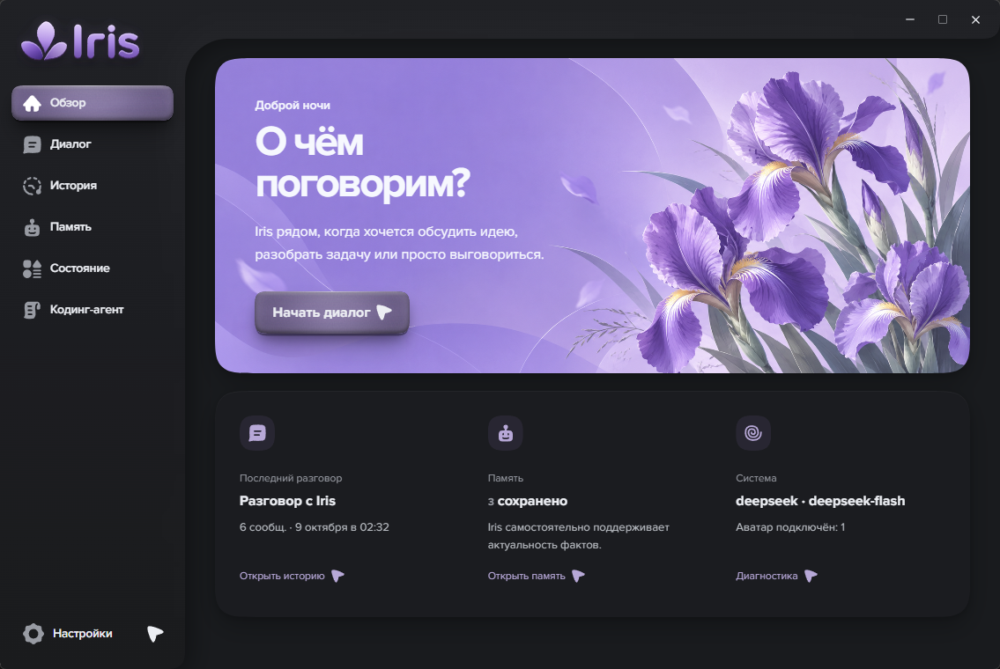
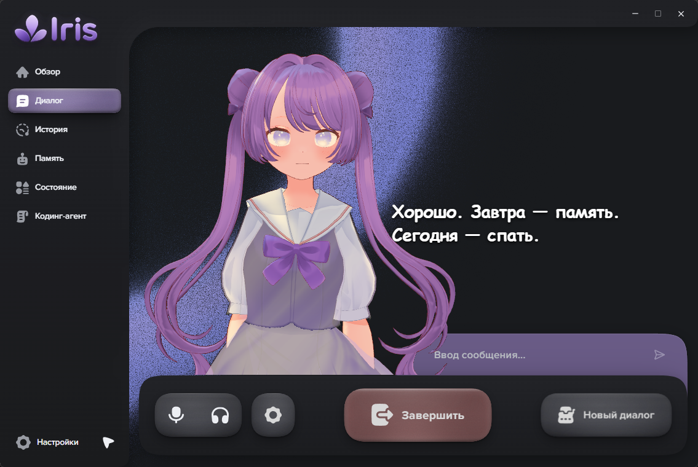
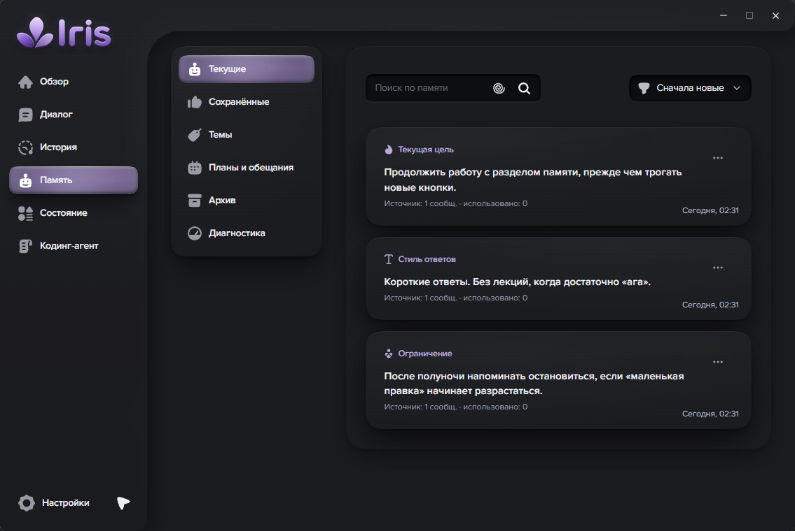
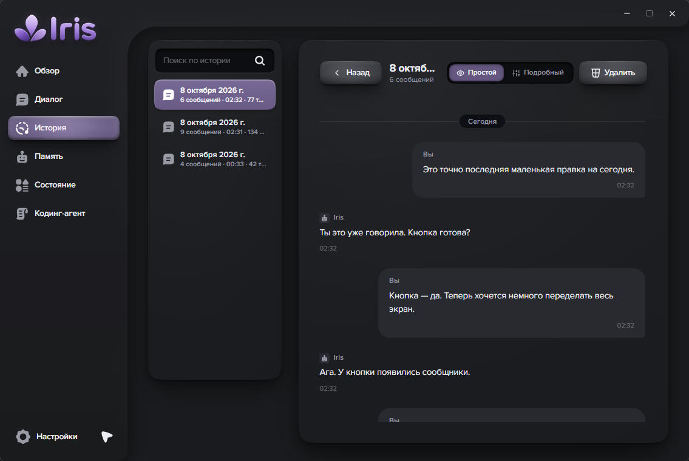
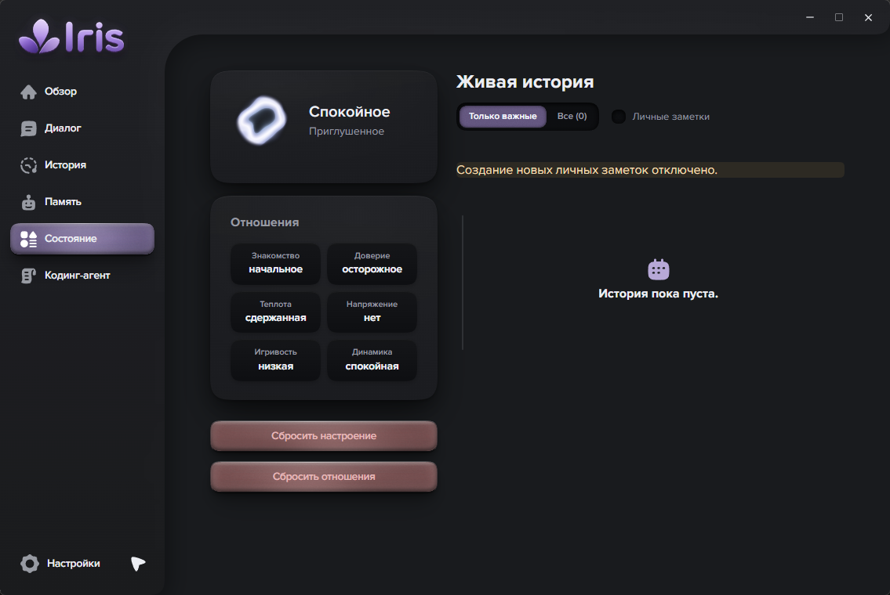
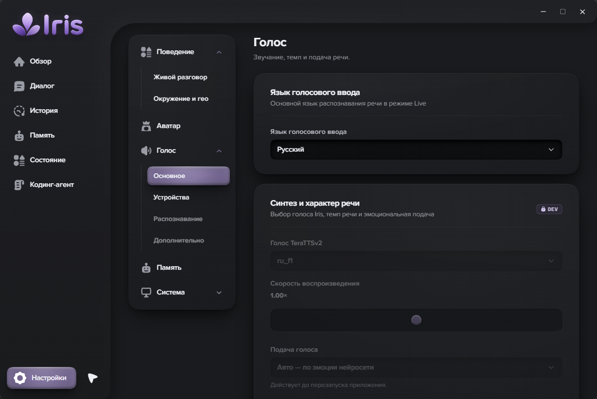
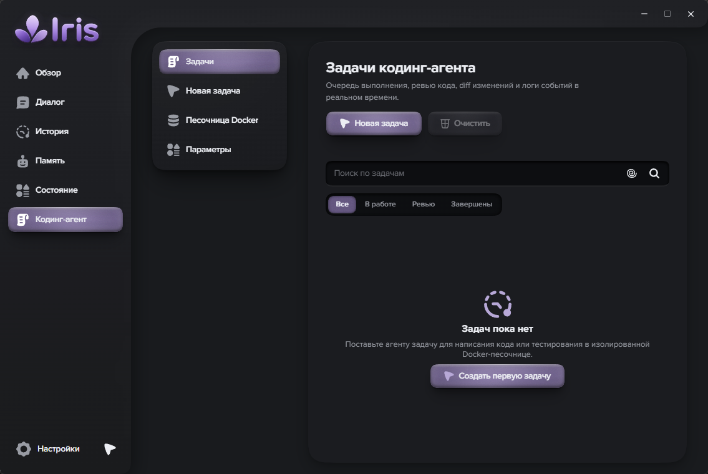
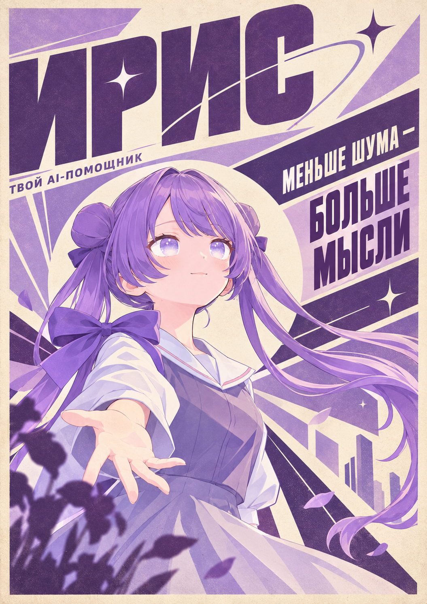
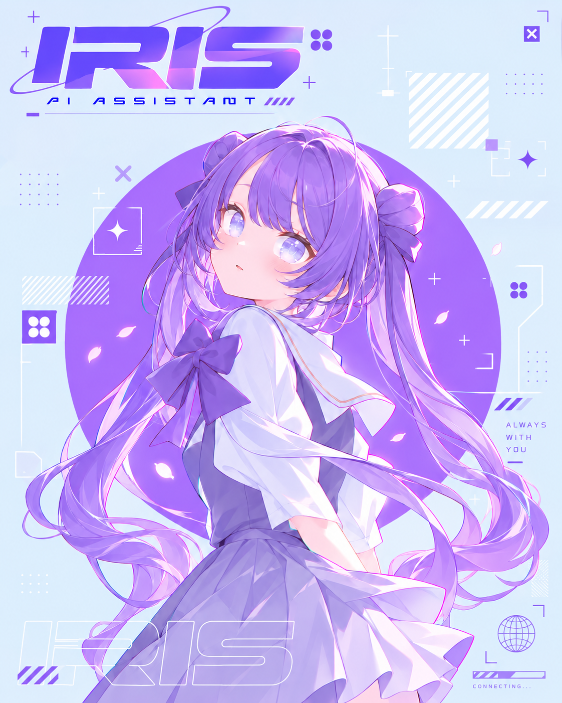
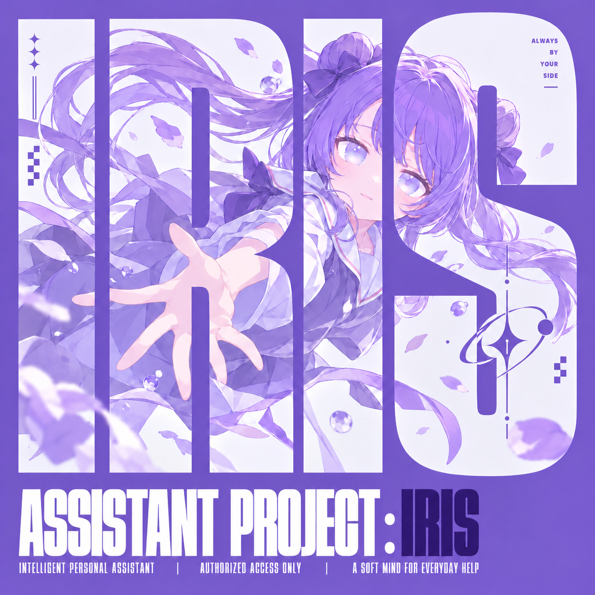

<div align="center">
  <picture>
    <source media="(prefers-color-scheme: dark)" srcset="Docs/media/readme/header.en.dark.png">
    
  </picture>

# Iris

A voice assistant for Windows: talk through an idea, work through a problem, or just have a conversation.<br>
Iris remembers useful details from your conversations; an optional avatar can sit beside the dialogue.

[Русский](README.md) · **English** · [Documentation](Docs/index.md)

[](VERSION) · [Apache 2.0](LICENSE)

[Features](#features) · [Interface](#interface) · [Requirements](#system-requirements) · [Getting started](#getting-started) · [Data](#data) · [Development](#development)

</div>

[](Docs/media/readme/overview.png)

<sub>Home screen</sub>

Speech recognition and synthesis run on your computer. Replies come from an external model, so conversations need internet access and an API key for your chosen provider.

For now, Iris runs from source. [Release status](Docs/MILESTONES.md).

## Features

**Conversation.** Write to Iris or talk to her. In voice mode, she detects the end of your turn; you can interrupt a spoken reply. [Voice conversations](Docs/live-conversation.md).

**Memory.** Iris keeps useful details from your conversations. You can read, edit or delete records in the memory section. [How memory works](Docs/chroma-memory.md).

**Plans and documents.** Memory includes plans and reminders, search and sorting.
Attach TXT, MD or a text-based PDF to a conversation and inspect answer sources.
Attachments are temporary; new history records retain the answer and source
references. [User guide](Docs/user-guide.md).

**Getting started and navigation.** Setup helps prepare your first conversation;
**Ctrl+K** searches history, memory, plans and settings. Start with text and enable voice later.

**Search.** Iris can search when you need to check information or find news. Results and sources stay in history. Search notifications are off by default. [Search and news](Docs/awareness.md).

**Avatar.** An optional Unity avatar can appear on your desktop or inside the dialogue window. Lip movement and gestures accompany speech. [Avatar setup](apps/avatar-unity/README.md).

**Coding Agent.** A separate agent handles coding tasks in Docker. You can review changes before bringing them into your project. It requires Docker and its own API key. [Setup and access boundaries](Docs/coding-agent.md).

<p align="center">
  <picture>
    <source media="(prefers-color-scheme: dark)" srcset="Docs/media/readme/interface.en.dark.png">
    
  </picture>
</p>

## Interface

### Dialogue

[](Docs/media/readme/dialogue.png)

Write a message, start a voice conversation or read reply subtitles here. You can turn the avatar off.

### Memory

[](Docs/media/readme/memory.png)

Records from conversations show the message Iris learned them from.

<details>
<summary>History</summary>

[](Docs/media/readme/history.png)

Your conversations, with search across messages.

</details>

<details>
<summary>State</summary>

[](Docs/media/readme/state.png)

Iris's mood and relationship with the person she is talking to.

</details>

<details>
<summary>Voice settings</summary>

[](Docs/media/readme/voice-settings.png)

Microphone and output device selection is in the separate devices section.

</details>

<details>
<summary>Coding Agent</summary>

[](Docs/media/readme/coding.png)

Agent tasks, file changes and execution logs. There are no tasks in this screenshot yet.

</details>

<sub>Screenshots use the Russian interface and a separate profile with prepared conversation and memory examples.</sub>

## System requirements

For the current source launch with local voice and an external dialogue model:

| Component | Minimum — estimated baseline | Recommended |
| :--- | :--- | :--- |
| OS | Windows 10 22H2, x64 | Windows 11, x64 |
| Processor | 4 cores / 8 threads with AVX2 | AMD Ryzen 7 5700X, 8 cores / 16 threads |
| RAM | 8 GB; about 5 GiB available before launch | 16 GB; 32 GB when also running Docker, Unity Editor or demanding applications |
| Graphics | Integrated graphics for the UI; speech can run on the CPU without a dedicated GPU | NVIDIA GTX 1660 SUPER, 6 GB VRAM — reference for the avatar and optional CUDA STT |
| Free storage | 20 GiB for source, dependencies, models and temporary files | 30 GiB on an SSD; build tools, Unity and Docker need additional space |
| Connection and audio | Internet and a model API key; microphone and headphones or speakers for voice | Stable internet, microphone and headphones to reduce acoustic echo |

The minimum is estimated for voice without the avatar or Docker and has not been tested on an 8 GB computer. An isolated CPU run of the speech models used about 3.1 GiB of RAM; model weights occupy about 1.93 GiB. The 16 GB recommendation leaves room for Windows and the UI. A GPU is optional for voice; acceleration needs a [separate ONNX CUDA profile](Docs/dependencies.md#gigaam-onnx-и-локальное-ускорение-stt).

**Iris reference computer:** the developer's Ryzen 7 5700X, **32 GB RAM**, GTX 1660 SUPER **6 GB**, Windows 11 Pro x64. Hardware was checked on 12 October 2026. The RAM recommendation is reduced to 16 GB by estimation; this is not a separate test on a 16 GB machine. [Sizing, conditions and optional components](Docs/system-requirements.md) (Russian).

## Getting started

Running from source requires Git, **Python 3.12**, **Node.js 24 / npm 11**. Audio decoding uses bundled PyAV; global FFmpeg/FFprobe commands are not required. The Tauri shell also needs the current stable Rust selected by `rust-toolchain.toml`, Microsoft C++ Build Tools with **Desktop development with C++**, and WebView2 Runtime. Rust 1.77.2 in Cargo is a lower compatibility bound, not the compiler version to install. [Tauri Windows prerequisites](https://v2.tauri.app/start/prerequisites/).

### Install dependencies

```powershell
git clone https://github.com/bad1and/NeuroAsist.git Iris
cd Iris

py -3.12 -m venv .venv
.\.venv\Scripts\python.exe -m pip install --upgrade pip
.\.venv\Scripts\python.exe -m pip install -r requirements/torch-cpu.txt
.\.venv\Scripts\python.exe -m pip install -r requirements.txt

npm ci
npm ci --prefix apps/web
npm ci --prefix apps/desktop

if (-not (Test-Path .env)) { Copy-Item .env.example .env }
```

This is the base CPU profile. Add optional STT acceleration **after** it using the instructions below. [More on dependencies](Docs/dependencies.md).

### Open Iris

```powershell
npm --prefix apps/desktop run dev
```

The shell starts the interface and local backend for you. Save your dialogue model key in **Settings → System → API keys** (**Настройки → Система → API-ключи** in the Russian interface). Keys are stored in Windows Credential Manager; `.env` is for non-secret configuration.

You can start with a text conversation. For voice, wait for the speech models to load and select your microphone and output device. Downloading the models requires internet access and disk space.

To exit completely, close the main window or choose **Quit** (**Выйти** in the Russian interface) from the Iris icon's menu in the Windows notification area. Minimizing the window keeps the app running. [First launch and everyday use](Docs/user-guide.md).

<details>
<summary>CUDA — faster speech recognition</summary>

An NVIDIA GPU can accelerate the current GigaAM ONNX provider. After installing the base profile, replace CPU ONNX Runtime with the GPU variant:

```powershell
.\.venv\Scripts\python.exe -m pip uninstall -y onnxruntime
.\.venv\Scripts\python.exe -m pip install -r requirements/stt-cuda.txt
.\.venv\Scripts\python.exe scripts/check_python_dependencies.py --stt-cuda
```

Keep `VOICE_STT_DEVICE=auto` in `.env` to select CUDA with CPU recovery. A compatible NVIDIA driver is required; CPU and GPU ONNX Runtime must not coexist. PyTorch and TeraTTSv2 remain on the CPU. `torch-cu128.txt` selects PyTorch wheels and does not itself accelerate GigaAM ONNX. [Validation and return to CPU](Docs/dependencies.md#gigaam-onnx-и-локальное-ускорение-stt).

</details>

<details>
<summary>Unity — rebuilding the avatar</summary>

The avatar is optional. A new clone has no built executable: its first build and later rebuilds require Unity 2022.3.62f3 with **Windows Build Support (Mono)**:

```powershell
$env:NEUROASIST_UNITY_EDITOR = 'C:\Program Files\Unity\Hub\Editor\2022.3.62f3\Editor\Unity.exe'
npm --prefix apps/desktop run build:avatar
```

[Building and configuring the Unity avatar](apps/avatar-unity/README.md).

After the build, Tauri discovers it automatically. Text and voice are available without it.

</details>

<details>
<summary>Docker — the Coding Agent environment</summary>

Start Docker Desktop. You can prepare the image from Coding Agent; this command is also available for development:

```powershell
docker build -t neuroasist-coding:1.0.0 -f apps/backend/docker/coding.Dockerfile apps/backend/docker
```

Save a separate Coding API key in the app settings and enable the agent. It does not use the dialogue model key. [Full instructions](Docs/coding-agent.md).

</details>

<details>
<summary>Browser mode — interface and backend development</summary>

In two PowerShell windows:

```powershell
.\.venv\Scripts\python.exe -m uvicorn main:app --host 127.0.0.1 --port 8000 --ws websockets-sansio --reload
```

```powershell
npm --prefix apps/web run dev
```

Interface: `http://127.0.0.1:5173`. API documentation: `http://127.0.0.1:8000/docs`.

Browser mode does not receive keys from Windows Credential Manager. Launch through Tauri to make model requests.

</details>

If the app will not start or you cannot hear the voice, begin with [troubleshooting](Docs/operations.md#диагностика).

## Data

History, memory and settings stay on your computer. When launched through Tauri, they are stored in `%LOCALAPPDATA%\NeuroAsist`. Microphone audio is not saved by default.

To reply, the model receives your request text and selected conversation context. Search contacts external sources. [More on data](PRIVACY.md).

Deleting a memory record and deleting its source message are separate actions. Settings support creating, importing, exporting and restoring backups. The desktop shell stops the core before replacing data and preserves the previous copy. Iris does not provide general desktop control, and Coding Agent runs in its own isolated environment.

[Security](SECURITY.md) · [Project status](Docs/MILESTONES.md) · [Release requirements](Docs/release-checklist.md)

## Development

| Directory | Contents |
| :--- | :--- |
| `apps/web` | React interface |
| `apps/backend` | Conversation, speech, memory and local API |
| `apps/desktop` | Windows shell built with Tauri |
| `apps/avatar-unity` | Optional Unity avatar |
| `apps/protocol` | Shared character and avatar contracts |
| `Docs`, `scripts`, `tests` | Documentation, tools and checks |

Main checks, run from the repository root:

```powershell
.\.venv\Scripts\python.exe -m pytest -q
npm --prefix apps/web test
npm --prefix apps/web run build
npm --prefix apps/desktop run check
.\.venv\Scripts\python.exe scripts/check_docs.py
```

[Documentation](Docs/index.md) · [Architecture](Docs/architecture.md) · [Contributing](CONTRIBUTING.md) · [Iris design](design.md)

The version comes from `VERSION`. Installer builds and pre-publication checks are described in [operations](Docs/operations.md) and the [release runbook](Docs/release-runbook.md). Linked subsystem guides are currently in Russian.

<p align="center">
  <a href="Docs/media/readme/poster-less-noise.png"></a>
  <a href="Docs/media/readme/poster-always-with-you.png"></a>
  <a href="Docs/media/readme/poster-assistant-project.png"></a>
</p>

---

The code is licensed under [Apache 2.0](LICENSE). Models, the avatar and other third-party materials have their own terms: [inventory and provenance](THIRD_PARTY_ASSETS.md).

[Documentation](Docs/index.md) · [Changelog](CHANGELOG.md) · [Русский](README.md) · [Back to top](#iris)
