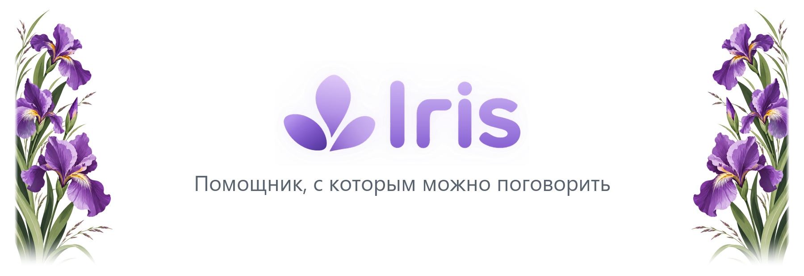
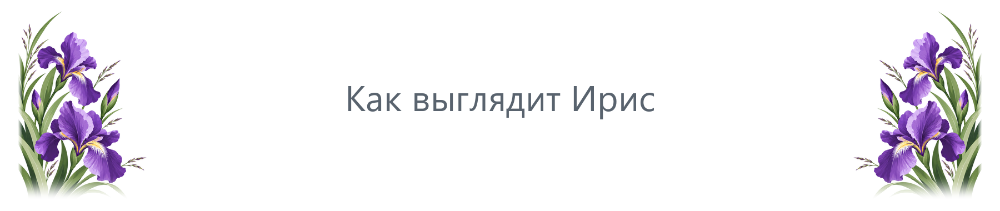

<div align="center">
  <picture>
    <source media="(prefers-color-scheme: dark)" srcset="Docs/media/readme/header.ru.dark.png">
    
  </picture>

# Ирис

Голосовой помощник для Windows, с которым можно обсудить идею, разобрать задачу или просто поговорить.<br>
Ирис помнит важное из бесед; рядом с окном диалога можно разместить аватар.

**Русский** · [English](README.en.md) · [Документация](Docs/index.md)

[](VERSION) · [Apache 2.0](LICENSE)

[Возможности](#возможности) · [Интерфейс](#интерфейс) · [Запуск](#запуск) · [Данные](#данные) · [Разработка](#разработка)

</div>

[](Docs/media/readme/overview.png)

<sub>Главный экран</sub>

Распознавание и озвучивание речи работают на компьютере. За ответы отвечает внешняя модель: для разговора нужны интернет и API-ключ выбранного сервиса.

Пока Ирис запускается из исходников. [Статус выпуска](Docs/MILESTONES.md).

## Возможности

**Разговор.** С Ирис можно говорить голосом или переписываться. В голосовом режиме она определяет конец реплики; ответ можно перебить. [О голосовом разговоре](Docs/live-conversation.md).

**Память.** Ирис сохраняет важные сведения из бесед. Записи можно прочитать, исправить или удалить в разделе памяти. [Как работает память](Docs/chroma-memory.md).

**Поиск.** Если нужно проверить информацию или найти новости, Ирис может обратиться к поиску. Результаты и источники остаются в истории. Уведомления о поиске по умолчанию выключены. [Поиск и новости](Docs/awareness.md).

**Аватар.** Необязательный Unity-аватар можно разместить на рабочем столе или внутри окна диалога. Он сопровождает речь движением губ и жестами. [Настройка аватара](apps/avatar-unity/README.md).

**Coding Agent.** Отдельный агент работает с задачами по коду в Docker. Изменения можно просмотреть перед переносом в проект. Для него нужны Docker и собственный API-ключ. [Настройка и границы доступа](Docs/coding-agent.md).

<p align="center">
  <picture>
    <source media="(prefers-color-scheme: dark)" srcset="Docs/media/readme/interface.ru.dark.png">
    
  </picture>
</p>

## Интерфейс

### Диалог

[](Docs/media/readme/dialogue.png)

Здесь можно писать, включать голосовой разговор и читать субтитры ответа. Аватар можно отключить.

### Память

[](Docs/media/readme/memory.png)

У записей из бесед можно посмотреть источник — сообщение, из которого Ирис их запомнила.

<details>
<summary>История</summary>

[](Docs/media/readme/history.png)

Список бесед и поиск по сообщениям.

</details>

<details>
<summary>Состояние</summary>

[](Docs/media/readme/state.png)

Настроение Ирис и состояние отношений с собеседником.

</details>

<details>
<summary>Настройки голоса</summary>

[](Docs/media/readme/voice-settings.png)

Микрофон и устройство вывода выбираются отдельно, в разделе устройств.

</details>

<details>
<summary>Coding Agent</summary>

[](Docs/media/readme/coding.png)

Задачи агента, изменения в файлах и журнал выполнения. На снимке задач ещё нет.

</details>

<sub>Снимки сделаны в отдельном профиле с подготовленными примерами разговоров и памяти.</sub>

## Запуск

Для запуска из исходников понадобятся **Windows 10 или 11**, Git, **Python 3.12**, **Node.js 24 / npm 11**, FFmpeg и FFprobe в `PATH`. Для оболочки Tauri нужны Rust 1.77.2 или новее, Microsoft C++ Build Tools и WebView2 Runtime.

### Установить зависимости

```powershell
git clone https://github.com/bad1and/NeuroAsist.git Iris
cd Iris

python -m venv .venv
.\.venv\Scripts\python.exe -m pip install --upgrade pip
.\.venv\Scripts\python.exe -m pip install -r requirements.txt

npm ci
npm ci --prefix apps/web
npm ci --prefix apps/desktop

Copy-Item .env.example .env
```

Для CUDA сначала установите профиль из блока ниже, затем `requirements.txt`. [Подробнее о зависимостях](Docs/dependencies.md).

### Открыть Ирис

```powershell
npm --prefix apps/desktop run dev
```

Оболочка сама запускает интерфейс и локальное ядро. В **Настройки → Система → API-ключи** сохраните ключ модели диалога. Ключи хранятся в Windows Credential Manager; `.env` предназначен для несекретных параметров.

Для первого разговора достаточно текста. Чтобы включить голос, дождитесь загрузки речевых моделей и выберите микрофон и устройство вывода. Для скачивания моделей понадобятся интернет и место на диске.

Для полного выхода используйте **Quit** в меню значка Ирис в области уведомлений Windows. [Первый запуск и повседневная работа](Docs/user-guide.md).

<details>
<summary>CUDA — ускорение распознавания речи</summary>

Видеокарта NVIDIA может ускорить распознавание речи. Перед `requirements.txt` установите CUDA-профиль:

```powershell
.\.venv\Scripts\python.exe -m pip install -r requirements/torch-cu128.txt
```

Если CUDA недоступна, используйте `VOICE_STT_DEVICE=cpu` в `.env`. Стандартный профиль синтеза TeraTTSv2 работает на CPU.

</details>

<details>
<summary>Unity — пересборка аватара</summary>

Готовую локальную сборку аватара Tauri находит автоматически. Unity 2022.3.62f3 нужен только для пересборки после изменений:

```powershell
$env:NEUROASIST_UNITY_EDITOR = 'C:\Program Files\Unity\Hub\Editor\2022.3.62f3\Editor\Unity.exe'
npm --prefix apps/desktop run build:avatar
```

[Сборка и настройка Unity-аватара](apps/avatar-unity/README.md).

</details>

<details>
<summary>Docker — среда для Coding Agent</summary>

Запустите Docker Desktop и соберите образ:

```powershell
docker build -t neuroasist-coding:latest -f apps/backend/docker/coding.Dockerfile apps/backend/docker
```

Сохраните отдельный Coding API-ключ в настройках приложения и включите агента. Ключ диалоговой модели вместо него не используется. [Полная инструкция](Docs/coding-agent.md).

</details>

<details>
<summary>Браузерный режим — разработка интерфейса и ядра</summary>

В двух окнах PowerShell:

```powershell
.\.venv\Scripts\python.exe -m uvicorn main:app --host 127.0.0.1 --port 8000 --reload
```

```powershell
npm --prefix apps/web run dev
```

Интерфейс — `http://127.0.0.1:5173`, описание API — `http://127.0.0.1:8000/docs`.

Браузерный режим не получает ключи из Windows Credential Manager. Для запросов к модели запускайте приложение через Tauri.

</details>

Если приложение не запускается или не слышно голос, начните с [диагностики](Docs/operations.md#диагностика).

## Данные

История, память и настройки хранятся на компьютере. При запуске через Tauri — в `%LOCALAPPDATA%\NeuroAsist`. Запись с микрофона по умолчанию не сохраняется.

Для ответа модель получает текст запроса и выбранный контекст беседы. Поиск обращается к внешним источникам. [Подробнее о данных](PRIVACY.md).

Удаление записи памяти и исходного сообщения — разные действия. Резервные копии можно создавать в настройках; восстановления через интерфейс пока нет. Ирис не предоставляет общего управления рабочим столом, а Coding Agent работает в своей изолированной среде.

[Безопасность](SECURITY.md) · [Текущий статус проекта](Docs/MILESTONES.md) · [Условия выпуска](Docs/release-checklist.md)

## Разработка

| Каталог | Что внутри |
| :--- | :--- |
| `apps/web` | Интерфейс React |
| `apps/backend` | Диалог, голос, память и локальное API |
| `apps/desktop` | Оболочка Windows на Tauri |
| `apps/avatar-unity` | Необязательный Unity-аватар |
| `apps/protocol` | Общие контракты персонажа и аватара |
| `Docs`, `scripts`, `tests` | Документация, инструменты и проверки |

Основные проверки из корня репозитория:

```powershell
.\.venv\Scripts\python.exe -m pytest -q
npm --prefix apps/web test
npm --prefix apps/web run build
npm --prefix apps/desktop run check
.\.venv\Scripts\python.exe scripts/check_docs.py
```

[Документация](Docs/index.md) · [Архитектура](Docs/architecture.md) · [Участие в разработке](CONTRIBUTING.md) · [Дизайн Ирис](design.md)

Версию задаёт `VERSION`. Порядок сборки установщика и проверки перед публикацией описаны в [эксплуатации](Docs/operations.md) и [руководстве выпуска](Docs/release-runbook.md).

<p align="center">
  <a href="Docs/media/readme/poster-less-noise.png"></a>
  <a href="Docs/media/readme/poster-always-with-you.png"></a>
  <a href="Docs/media/readme/poster-assistant-project.png"></a>
</p>

---

Код распространяется по [Apache 2.0](LICENSE). У моделей, аватара и других сторонних материалов свои условия: [состав и происхождение](THIRD_PARTY_ASSETS.md).

[Документация](Docs/index.md) · [История изменений](CHANGELOG.md) · [English](README.en.md) · [К началу](#ирис)
